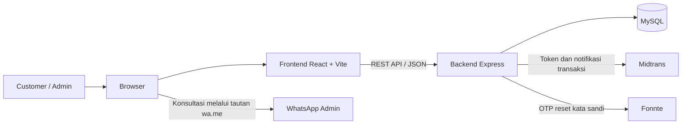

# Tahapan Pembuatan Proyek SIREMINS

**SIREMINS (Sistem Informasi dan Reservasi Arena Olahraga)** adalah aplikasi
reservasi Cikajang Sport Center. Dokumen ini menjelaskan tahapan pengembangan
berdasarkan fitur yang telah tersedia pada proyek saat ini, termasuk hal yang
masih perlu disiapkan untuk penggunaan produksi.

## Daftar Isi

1. [Gambaran Umum](#1-gambaran-umum)
2. [Tahap 1: Analisis Kebutuhan](#2-tahap-1-analisis-kebutuhan)
3. [Tahap 2: Persiapan Lingkungan](#3-tahap-2-persiapan-lingkungan)
4. [Tahap 3: Backend, Database, dan Pembayaran](#4-tahap-3-backend-database-dan-pembayaran)
5. [Tahap 4: Antarmuka Frontend](#5-tahap-4-antarmuka-frontend)
6. [Tahap 5: Integrasi dan Pengelolaan Sesi](#6-tahap-5-integrasi-dan-pengelolaan-sesi)
7. [Tahap 6: Pengujian dan Verifikasi](#7-tahap-6-pengujian-dan-verifikasi)
8. [Tahap 7: Persiapan dan Pengembangan Berikutnya](#8-tahap-7-persiapan-dan-pengembangan-berikutnya)

## 1. Gambaran Umum

SIREMINS memisahkan antarmuka dan layanan data dalam satu repositori:

- **Frontend:** React 19, Vite, Tailwind CSS, Framer Motion, Axios, dan
  Lucide React.
- **Backend:** Node.js dengan Express 5, menggunakan ES Modules dan REST API.
- **Database:** MySQL melalui `mysql2/promise`.
- **Pembayaran:** Midtrans Snap untuk pembayaran DP dan pelunasan.
- **Pesan WhatsApp:** tautan WhatsApp untuk konsultasi dari halaman kontak;
  layanan Fonnte untuk pengiriman OTP reset kata sandi.



## 2. Tahap 1: Analisis Kebutuhan

### 2.1 Peran pengguna

- **Pengunjung/customer:** melihat landing page dan fasilitas, membuat akun,
  masuk, mengelola profil, melihat jadwal, melakukan pemesanan, membayar DP
  atau pelunasan, serta memantau riwayat booking.
- **Admin:** masuk melalui alur admin, melihat dan mengelola booking, serta
  melihat atau mengelola data pengguna melalui dashboard.
- **Pengunjung umum:** mengirim pertanyaan kepada admin menggunakan formulir
  kontak WhatsApp.

### 2.2 Kebutuhan inti yang sudah diimplementasikan

1. Landing page responsif dengan carousel Hero dan katalog fasilitas.
2. Autentikasi customer dan admin dengan sesi berbasis JWT.
3. Pemilihan tanggal dan slot booking, validasi ketersediaan, serta
   perlindungan terhadap jadwal yang bertabrakan.
4. Riwayat booking customer, pengelolaan booking admin, pembatalan, dan
   penjadwalan ulang sesuai status yang diizinkan.
5. Pembayaran booking melalui Midtrans dan verifikasi status melalui backend.
6. Kontak admin melalui WhatsApp dan reset kata sandi dengan OTP WhatsApp.
7. Mode terang/gelap, tata letak responsif, dan motion yang menghormati
   preferensi `prefers-reduced-motion`.

## 3. Tahap 2: Persiapan Lingkungan

### 3.1 Prasyarat

- Node.js dan npm yang sesuai dengan versi yang didukung dependency proyek.
- MySQL dengan database development/staging.
- Kredensial Midtrans sandbox untuk menguji pembayaran.
- Token Fonnte untuk menguji pengiriman OTP.

### 3.2 Instalasi dependency

Jalankan perintah dari root repositori:

```powershell
cd backend
npm install

cd ..\frontend
npm install
```

Dependency frontend dan backend dikelola terpisah melalui
`frontend/package.json` dan `backend/package.json`.

### 3.3 Konfigurasi lokal

Simpan konfigurasi rahasia di file `.env` lokal yang tidak dilacak Git.
Jangan menyalin nilai kredensial ke dokumentasi, issue, atau bukti pengujian.

Backend menggunakan konfigurasi berikut sesuai fitur yang diaktifkan:

- `PORT` (opsional; default `5000`)
- `DB_HOST`, `DB_USER`, `DB_PASSWORD`, `DB_NAME`
- `JWT_SECRET` (minimal 32 karakter)
- `OTP_HASH_SECRET` (minimal 32 karakter)
- `FONNTE_TOKEN`
- `MIDTRANS_SERVER_KEY`
- `MIDTRANS_IS_PRODUCTION` (`false` untuk sandbox)

Frontend memakai `VITE_ADMIN_WHATSAPP_NUMBER` untuk menentukan nomor tujuan
formulir kontak. Nomor dapat diisi dengan format lokal atau internasional;
aplikasi menormalkannya untuk tautan WhatsApp. Lihat
`frontend/.env.example` dan `frontend/README.md` untuk petunjuknya. Isi nomor
admin yang benar sebelum fitur kontak dipakai.

## 4. Tahap 3: Backend, Database, dan Pembayaran

### 4.1 Koneksi dan migrasi database

`backend/db.mjs` membuat connection pool MySQL dengan batas koneksi yang
dikonfigurasi. Runner migrasi berada di `backend/scripts/migrate.mjs`.
Migrasi yang tersedia menyiapkan kolom relasi booking dan DP, tabel transaksi
Midtrans, serta tabel OTP reset kata sandi.

Pastikan tabel dasar proyek (`users` dan `bookings`) sudah tersedia pada
database yang dipilih. Periksa lalu jalankan migrasi dari folder backend:

```powershell
npm run migrate:status
npm run migrate
```

Runner menyimpan riwayat dan checksum migrasi di `schema_migrations`.
Lakukan pemeriksaan terpisah untuk setiap environment; jangan menguji migrasi
pada database produksi tanpa prosedur pencadangan dan persetujuan.

### 4.2 Autentikasi dan akun

Endpoint autentikasi utama:

- `POST /api/auth/register` — membuat akun customer dan menyimpan hash kata
  sandi.
- `POST /api/auth/login` — autentikasi customer menggunakan nomor HP dan
  kata sandi.
- `POST /api/auth/admin-login` — autentikasi admin.
- `GET /api/auth/me` dan `GET /api/admin/me` — validasi token dan identitas
  sesi sesuai peran.
- `PUT /api/auth/update-profile` — memperbarui profil customer yang
  terautentikasi.
- `POST /api/auth/request-password-reset-otp` dan
  `POST /api/auth/reset-password` — meminta serta memverifikasi OTP reset
  kata sandi yang dikirim melalui Fonnte.

JWT memiliki masa berlaku satu hari. Akses ke route terlindungi memeriksa token
dan peran pengguna di backend. Alur OTP menggunakan masa berlaku lima menit,
batas percobaan, dan jeda permintaan ulang.

### 4.3 Booking dan ketersediaan jadwal

- `GET /api/booking-pricing` memberikan konfigurasi harga dan minimum DP yang
  digunakan frontend dan backend.
- `GET /api/bookings?date=YYYY-MM-DD` menyediakan jadwal untuk tanggal yang
  dipilih.
- `POST /api/bookings` membuat booking customer terautentikasi. Identitas
  pemesan diambil dari sesi terverifikasi; backend memvalidasi tanggal,
  rentang waktu, durasi, DP, dan benturan jadwal.
- Konflik jadwal dikembalikan sebagai HTTP `409`; slot dikunci dan diperiksa
  kembali ketika operasi booking terkait memerlukan perlindungan terhadap
  pemesanan bersamaan.
- Booking baru berstatus `PENDING_DP`. Pembayaran DP yang terverifikasi
  mengubahnya menjadi `BOOKED`; pelunasan terverifikasi mengubahnya menjadi
  `BOOKED_PAID`.
- `GET /api/my-bookings` hanya memberikan riwayat milik customer yang sedang
  masuk.
- Customer dapat membatalkan booking yang statusnya diizinkan dan melakukan
  penjadwalan ulang hanya pada status yang diperbolehkan backend.
- Scheduler backend memeriksa booking yang belum lunas setiap menit dan
  membatalkan status `PENDING_DP` atau `BOOKED` jika waktu main telah
  mendekati batas yang ditetapkan sistem.

### 4.4 Pembayaran Midtrans

Endpoint pembayaran:

- `POST /api/payment/token` membuat token Snap untuk pembayaran DP atau
  pelunasan pada booking milik customer yang sedang masuk.
- `POST /api/payment/notification` menerima notifikasi Midtrans.

Backend menyimpan transaksi dengan `order_id` unik, memverifikasi signature
notifikasi, meminta status transaksi langsung dari Midtrans, lalu mencocokkan
jumlah pembayaran dengan catatan lokal. Hanya status transaksi yang memenuhi
verifikasi backend yang dapat mengubah status booking. Callback di browser
tidak menjadi sumber kebenaran status pembayaran.

Jika pembayaran berhasil tetapi booking sudah dibatalkan atau tidak dapat
dikonfirmasi, transaksi dapat ditandai `PAID_REVIEW` untuk ditinjau secara
manual. Sebelum menerima pembayaran, konfigurasi Midtrans dan migrasi tabel
`midtrans_payment_transactions` harus tersedia.

### 4.5 Route admin dan kesehatan API

Route `/api/admin/*` dilindungi autentikasi dan pemeriksaan peran admin.
Dashboard menggunakan layanan untuk melihat serta mengelola booking dan data
pengguna. `GET /api/health` menyediakan pemeriksaan sederhana bahwa API
berjalan.

## 5. Tahap 4: Antarmuka Frontend

Komponen utama berada di `frontend/src/components/` dan dirangkai oleh
`frontend/src/App.jsx`.

### 5.1 Landing page

- **Navbar:** navigasi halaman, kontrol tema, dan menu akun sesuai status
  login.
- **Hero:** carousel gambar fasilitas dengan transisi, overlay untuk
  keterbacaan teks, dan CTA menuju alur booking.
- **Features:** kartu arena Mini Soccer, Gym, Bulutangkis, Tenis Meja, dan
  Senam/Yoga, beserta informasi fasilitas pendukung. Kartu memakai efek
  hover, frame, dan glow; pilihan Mini Soccer membuka alur booking.
- **Mode tema:** warna dark menggunakan palet slate/dark-grey dan preferensi
  tema tersimpan pada browser.

### 5.2 Booking dan akun

- **BookingSection:** pemilih tanggal, jadwal, durasi, rincian harga dan DP,
  serta checkout pembayaran. Booking customer hanya dapat dibuat setelah
  login.
- **Login:** alur login customer/admin, pendaftaran customer, dan reset
  kata sandi berbasis OTP.
- **Account:** pengelolaan profil customer.
- **MyBookings:** riwayat booking, status, rincian pembayaran, dan aksi yang
  tersedia sesuai status.
- **AdminDashboard:** antarmuka admin untuk data booking dan pengguna.
- **Logout:** konfirmasi sebelum mengakhiri sesi.

### 5.3 Kontak dan footer

- **ContactSection:** memvalidasi konfigurasi nomor admin, menyusun pesan dari
  formulir, membuka tautan WhatsApp di tab baru, lalu mengosongkan formulir
  setelah pengiriman ke WhatsApp dimulai. Pengiriman pesan dilakukan melalui
  WhatsApp pengguna; formulir ini bukan endpoint pengiriman pesan backend.
- **Footer:** tersusun menjadi empat kolom horizontal pada layar lebar:
  identitas/deskripsi CSC menggunakan dua kolom, informasi kontak satu
  kolom, dan peta satu kolom. Tata letak menyesuaikan layar kecil.
- Motion footer membedakan arah masuk bagian kiri dan kanan serta menghormati
  pengaturan reduced motion perangkat.

## 6. Tahap 5: Integrasi dan Pengelolaan Sesi

`App.jsx` mengelola state utama, modal, tema, dan komunikasi API.

1. Axios menambahkan token customer atau admin ke header request yang sesuai.
2. Data akun dan token disimpan pada `localStorage`; tema disimpan pada
   `localStorage`, sedangkan modal aktif customer dicatat pada
   `sessionStorage`.
3. Setelah reload, aplikasi memanggil endpoint `/api/auth/me` atau
   `/api/admin/me` untuk memvalidasi sesi. Jika permintaan terlindungi
   mendapat respons `401`, token dan data akun yang terkait dibersihkan dan
   UI kembali ke keadaan logout.
4. Login customer tetap menampilkan landing page. Modal booking hanya dibuka
   ketika customer memilih aksi booking.
5. Saat tanggal booking berubah, frontend meminta jadwal terbaru ke backend.
   Harga yang ditampilkan menggunakan konfigurasi backend, bukan menjadi
   sumber perhitungan utama di browser.
6. Status pembayaran berasal dari backend setelah verifikasi notifikasi
   Midtrans, kemudian riwayat booking dapat dimuat ulang untuk menampilkan
   hasil terbaru.

## 7. Tahap 6: Pengujian dan Verifikasi

Gunakan `SKEMA_PENGUJIAN.md` sebagai daftar skenario fungsional customer,
admin, sesi, booking, pembayaran, dan antarmuka. Jalankan pengujian pada
database serta akun khusus development/staging.

Jalankan layanan secara lokal:

```powershell
# Terminal 1
cd backend
npm run dev

# Terminal 2
cd frontend
npm run dev
```

Pastikan `GET http://localhost:5000/api/health` merespons status `OK`.
Validasi frontend dari folder `frontend`:

```powershell
npx eslint src\components\Footer.jsx
npm run build
```

Perintah lint di atas adalah pemeriksaan terfokus untuk contoh komponen.
Untuk pemeriksaan penuh, jalankan `npm run lint`. Build dapat menampilkan
peringatan ukuran bundle; peringatan tersebut bukan kegagalan build jika
perintah selesai dengan sukses.

Catat hasil uji, lingkungan, langkah reproduksi, dan bukti yang telah
disamarkan. Jangan menyimpan token, OTP, password, atau kredensial pada bukti.

## 8. Tahap 7: Persiapan dan Pengembangan Berikutnya

Fitur autentikasi JWT, dashboard admin, integrasi pembayaran Midtrans, dan
pengiriman OTP WhatsApp sudah menjadi bagian implementasi saat ini, bukan
pekerjaan roadmap.

Hal yang masih perlu dipersiapkan atau dapat dikembangkan berikutnya:

1. **Persiapan produksi:** atur domain HTTPS, CORS yang sesuai, database
   produksi, backup dan pemulihan, logging, serta secret environment
   production. Jangan memakai kredensial sandbox atau secret development.
2. **Konfigurasi layanan:** masukkan nomor WhatsApp admin dan kredensial
   Fonnte/Midtrans yang benar pada environment deployment. Uji callback
   Midtrans dari endpoint publik sebelum pembayaran produksi diaktifkan.
3. **Deployment frontend dan backend:** tentukan hosting dan konfigurasi
   koneksi API untuk deployment; frontend saat ini menggunakan alamat API
   lokal yang ditetapkan di kode dan perlu disesuaikan untuk domain produksi.
4. **Otomasi pengujian:** tambahkan pengujian otomatis unit/integrasi untuk
   validasi jadwal, otorisasi peran, alur sesi, serta pemrosesan notifikasi
   pembayaran.
5. **Notifikasi booking:** jika diperlukan, kembangkan notifikasi WhatsApp
   otomatis untuk perubahan status booking. Saat ini WhatsApp digunakan untuk
   konsultasi dari browser dan pengiriman OTP reset kata sandi; notifikasi
   booking otomatis belum menjadi alur yang didokumentasikan sebagai fitur
   aktif.
6. **Pemantauan pembayaran:** siapkan prosedur operasional untuk memeriksa
   transaksi `PAID_REVIEW` dan tindak lanjut manual sesuai kebijakan
   pengelola.
