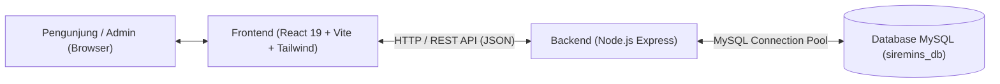
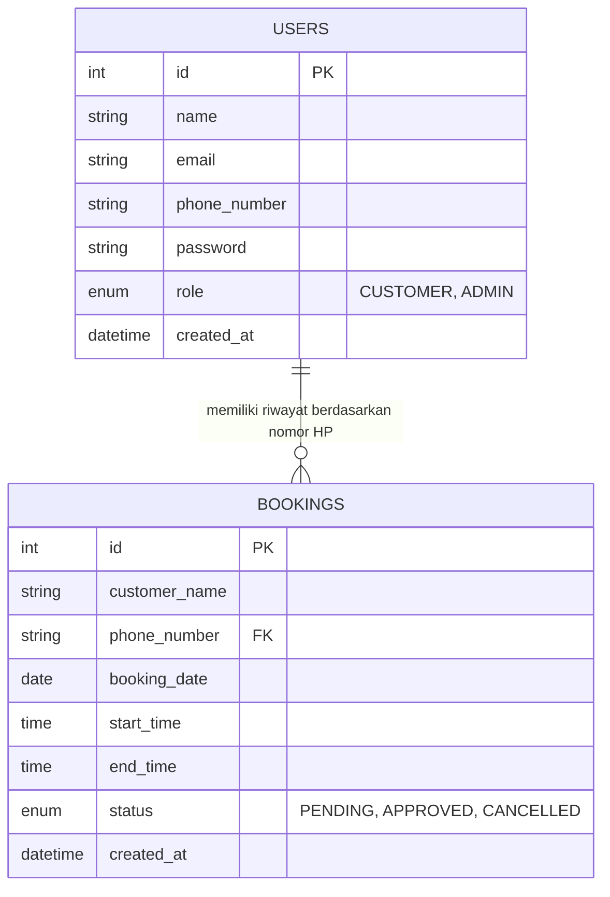
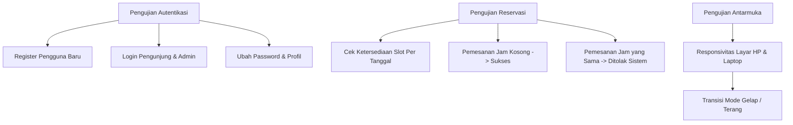

# 📘 PANDUAN TAHAP DEMI TAHAP PEMBUATAN PROYEK SIREMINS

_(Sistem Informasi & Reservasi Arena Olahraga Cikajang Sport Center)_

Dokumen ini mendokumentasikan alur lengkap proses pengembangan proyek **SIREMINS** dari awal (perancangan) hingga tahap implementasi, pengujian, dan rencana pengembangan selanjutnya. Dokumen ini sangat cocok sebagai acuan laporan tugas akhir, skripsi, maupun dokumentasi teknis tim developer.

---

## 📑 DAFTAR ISI

1. [Gambaran Umum & Metodologi Pengembangan](#1-gambaran-umum--metodologi-pengembangan)
2. [Tahap 1: Analisis Kebutuhan & Perancangan Sistem](#tahap-1-analisis-kebutuhan--perancangan-sistem)
3. [Tahap 2: Setup Lingkungan Kerja (Environment Setup)](#tahap-2-setup-lingkungan-kerja-environment-setup)
4. [Tahap 3: Implementasi Backend & Database (API Development)](#tahap-3-implementasi-backend--database-api-development)
5. [Tahap 4: Implementasi Antarmuka Pengguna Frontend (UI/UX)](#tahap-4-implementasi-antarmuka-pengguna-frontend-uiux)
6. [Tahap 5: Integrasi Frontend-Backend & State Management](#tahap-5-integrasi-frontend-backend--state-management)
7. [Tahap 6: Pengujian Sistem (Quality Assurance & Testing)](#tahap-6-pengujian-sistem-quality-assurance--testing)
8. [Tahap 7: Rencana Pengembangan Lanjutan (Future Roadmap)](#tahap-7-rencana-pengembangan-lanjutan-future-roadmap)

---

## 1. GAMBARAN UMUM & METODOLOGI PENGEMBANGAN

### 1.1 Latar Belakang

Cikajang Sport Center membutuhkan sistem reservasi digital mandiri untuk mempermudah pengunjung dalam mengecek ketersediaan jadwal lapangan (terutama Mini Soccer) secara _real-time_ serta melakukan pemesanan tanpa harus menunggu konfirmasi manual berulang kali melalui pesan instan.

### 1.2 Pendekatan Arsitektur

Proyek menggunakan arsitektur **Client-Server Terpisah (Decoupled Architecture)** dalam repositori tunggal (_Monorepo_):

- **Frontend:** Single Page Application (SPA) berbasis React 19 + Vite yang ringan dan interaktif.
- **Backend:** REST API menggunakan Node.js Express (ES Module) yang menangani logika bisnis dan autentikasi.
- **Database:** MySQL relational database untuk menjamin integritas data transaksi jadwal pemesanan.



---

## TAHAP 1: ANALISIS KEBUTUHAN & PERANCANGAN SISTEM

### 1.1 Identifikasi Aktor (Pengguna)

1. **Pengunjung (User / Customer):**
   - Melihat katalog arena olahraga dan fasilitas pendukung.
   - Melakukan registrasi, login, dan reset password dengan nomor telepon.
   - Melihat jadwal lapangan yang kosong/terisi pada tanggal yang dipilih.
   - Melakukan reservasi lapangan (slot jam 08:00 - 24:00).
   - Mengelola profil (ubah nama dan kata sandi).
   - Memantau status pemesanan di menu _Riwayat Booking_.
   - Mengirim pesan konsultasi via WhatsApp admin.
2. **Administrator:**
   - Login melalui kredensial khusus administrator.
   - Memvalidasi bukti pembayaran / Down Payment (DP).
   - Mengubah status pesanan (_PENDING_, _APPROVED_, _CANCELLED_).

### 1.2 Perancangan Skema Database (ERD)



---

## TAHAP 2: SETUP LINGKUNGAN KERJA (ENVIRONMENT SETUP)

Langkah awal pembuatan struktur folder proyek:

### 2.1 Inisialisasi Frontend

1. Membuat proyek baru dengan Vite dan template React:
   ```powershell
   npm create vite@latest frontend -- --template react
   cd frontend
   npm install
   ```
2. Menginstall dependensi esensial:
   ```powershell
   npm install @tailwindcss/vite tailwindcss framer-motion lucide-react axios
   ```
3. Mengonfigurasi `vite.config.js` untuk plugin React dan Tailwind v4.

### 2.2 Inisialisasi Backend

1. Membuat direktori backend dan inisialisasi package:
   ```powershell
   mkdir backend
   cd backend
   npm init -y
   ```
2. Mengaktifkan ES Module dengan menambahkan `"type": "module"` di `backend/package.json`.
3. Menginstall dependensi:
   ```powershell
   npm install express cors dotenv mysql2 jsonwebtoken bcryptjs
   npm install -D nodemon
   ```
4. Menyiapkan konfigurasi environment `.env` untuk port server dan kredensial database.
   PORT=5000
   DB_HOST=187.77.125.197
   DB_USER=admin_siremins
   DB_PASSWORD=Illyas@1992@
   DB_NAME=siremins_db

---

## TAHAP 3: IMPLEMENTASI BACKEND & DATABASE (API DEVELOPMENT)

Pengembangan logika backend pada file `backend/db.mjs` dan `backend/index.mjs`:

### 3.1 Koneksi Database Pool (`db.mjs`)

- Menggunakan `mysql2/promise` createPool untuk koneksi efisien dan _non-blocking_.
- Menjaga toleransi koneksi dengan konfigurasi `connectionLimit: 10`.

### 3.2 Pembuatan Endpoint Autentikasi

1. `POST /api/auth/register`:
   - Validasi data input pengunjung (nama, nomor HP, password).
   - Hashing password dengan algoritma `bcryptjs` salt rounds 10.
   - Penyimpanan pengguna dengan role _CUSTOMER_.
2. `POST /api/auth/login`:
   - Pencocokan nomor HP dan verifikasi hash password.
   - Pembuatan tanda pengenal sesi berupa JSON Web Token (JWT) dengan masa berlaku 1 hari.
3. `POST /api/auth/reset-password`:
   - Pengecekan nomor HP terdaftar dan update hash kata sandi baru.
4. `POST /api/auth/admin-login`:
   - Login khusus email dan verifikasi role _ADMIN_.

### 3.3 Pembuatan Endpoint Transaksi Reservasi

1. `GET /api/bookings?date=YYYY-MM-DD`:
   - Mengembalikan daftar jam yang sudah dipesan agar frontend dapat mewarnai slot (merah/kuning).
2. `POST /api/bookings`:
   - Memvalidasi tidak adanya jadwal bertabrakan menggunakan query overlap:
     `(start_time < new_end_time AND end_time > new_start_time)`.
   - Menyimpan jadwal baru dengan status awal _PENDING_.
3. `GET /api/my-bookings?phone_number=...`:
   - Menampilkan seluruh riwayat reservasi pelanggan diurutkan dari tanggal terbaru.
4. `PUT /api/auth/update-profile`:
   - Memperbarui nama dan kata sandi akun pelanggan.

---

## TAHAP 4: IMPLEMENTASI ANTARMUKA PENGGUNA FRONTEND (UI/UX)

Pembuatan komponen antarmuka yang modular di folder `frontend/src/components/`:

### 4.1 Struktur Komponen Visual

1. **Navbar (`Navbar.jsx`):**
   - Header fixed dengan efek blur saat digulir (_glassmorphism_).
   - Sakelar tema Gelap / Terang (_Dark/Light Mode_).
   - Menu dropdown pengguna: Info Akun, Riwayat Booking, dan Logout.
2. **Hero Section (`Hero.jsx`):**
   - Carousel gambar fasilitas utama otomatis berganti per 5 detik.
   - Indikator _Live Reservation_ dan tombol CTA langsung menuju form booking.
3. **Katalog Fasilitas (`Features.jsx`):**
   - Kartu interaktif arena: Mini Soccer, Pusat Gym, Lapangan Bulutangkis, Tenis Meja, dan Sanggar Senam.
   - Fasilitas pendukung (Shower, Loker, Kantin, Mushola).
4. **Formulir Kontak & Konsultasi (`ContactSection.jsx`):**
   - Integrasi form ke tautan WhatsApp API resmi pengelola arena.
5. **Footer (`Footer.jsx`):**
   - Identitas pengelola, tautan lokasi Google Maps, kontak operasional, dan hak cipta.

### 4.2 Struktur Komponen Interaktif (Modal Popup)

1. **Modal Reservasi (`BookingSection.jsx`):**
   - Pemilih tanggal (_date picker_).
   - Grid slot waktu dari 08:00 sampai 24:00 WIB.
   - Penanda warna status: Hijau (Kosong), Kuning (Menunggu DP), Merah (Terpesan).
   - Pemilihan durasi sewa fleksibel (1 jam, 2 jam, dst).
2. **Modal Autentikasi (`Login.jsx`):**
   - Tab dinamis: Pengunjung vs Administrator.
   - Sub-tampilan Pengunjung: Form Masuk, Form Daftar Baru, Form Lupa Password.
3. **Modal Akun Pengguna (`Account.jsx`):**
   - Form ubah nama tampilan dan ganti kata sandi dengan verifikasi kata sandi lama.
4. **Modal Riwayat Pemesanan (`MyBookings.jsx`):**
   - Kartu daftar pemesanan dengan tanggal lokal Indonesia dan badge status (_DIKONFIRMASI_, _MENUNGGU_, _DIBATALKAN_).
5. **Modal Konfirmasi Keluar (`Logout.jsx`):**
   - Dialog konfirmasi pencegah ketidaksengajaan keluar akun.

---

## TAHAP 5: INTEGRASI FRONTEND-BACKEND & STATE MANAGEMENT

Pengaturan state sentral di `frontend/src/App.jsx`:

1. **Sinkronisasi Sesi Lokal:**
   - Menyimpan `userData`, `adminData`, dan preferensi tema `siremins-theme` di `localStorage`.
2. **Pencegahan Scroll Bocor (_Body Scroll Lock_):**
   - Menambahkan efek `document.body.style.overflow = "hidden"` saat ada modal popup yang terbuka agar layar belakang tidak bergeser.
3. **Pemuatan Real-Time Slot Jadwal:**
   - Setiap kali tanggal pada form booking diubah, Axios memanggil data terbaru dari API backend untuk mencegah double booking.

---

## TAHAP 6: PENGUJIAN SISTEM (QUALITY ASSURANCE & TESTING)

Pengujian dilakukan untuk memastikan keandalan alur sistem:



---

## TAHAP 7: RENCANA PENGEMBANGAN LANJUTAN (FUTURE ROADMAP)

Langkah-langkah strategis untuk menyempurnakan aplikasi ke versi siap produksi (Production-Ready):

1. **Dashboard Khusus Admin (Admin Panel UI):**
   - Antarmuka bagi admin untuk mengubah status booking pengunjung (_PENDING_ menjadi _APPROVED_ atau _CANCELLED_).
   - Laporan ringkasan pendapatan harian dan bulanan.
2. **Upload Bukti Transfer / Integrasi Payment Gateway:**
   - Fitur unggah file foto/struk bukti transfer DP pada menu riwayat booking.
   - Opsi integrasi otomatis menggunakan Payment Gateway (seperti Midtrans atau Xendit).
3. **Penerapan Middleware Autentikasi JWT:**
   - Memproteksi seluruh rute privat backend dengan token otorisasi header `Bearer <token>`.
4. **Notifikasi WhatsApp Otomatis (Fonnte / WhatsApp Cloud API):**
   - Mengirimkan pesan konfirmasi pemesanan otomatis ke nomor WhatsApp pelanggan setelah reservasi diverifikasi oleh admin.
5. **Deployment:**
   - Frontend: Vercel / Netlify.
   - Backend: VPS (Ubuntu) / Cloud Server dengan reverse proxy Nginx dan SSL HTTPS.
   - Database: Cloud Database terkelola.
